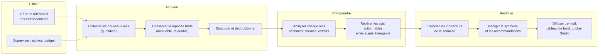
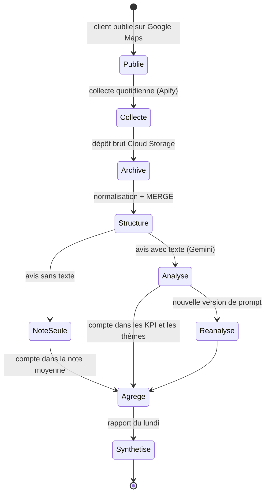
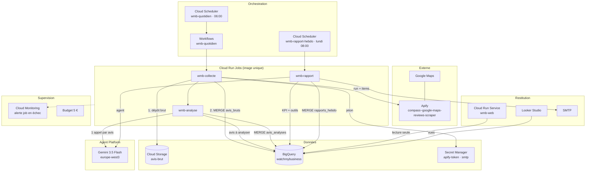
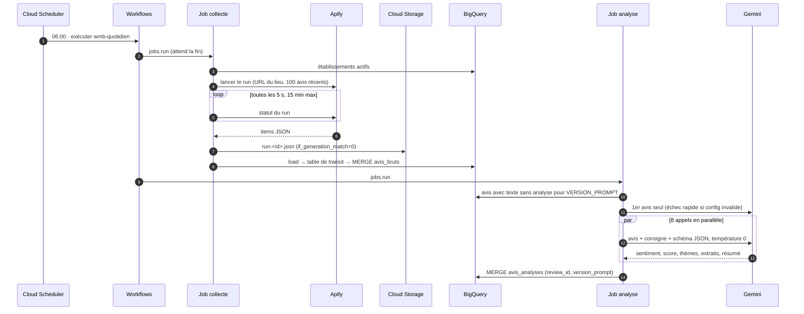
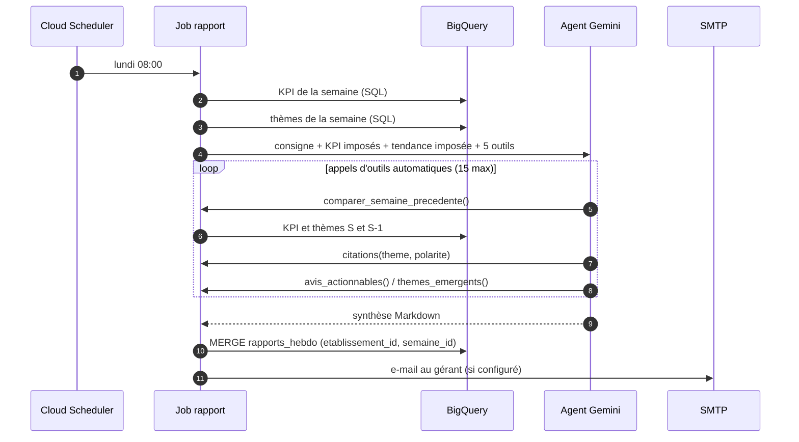
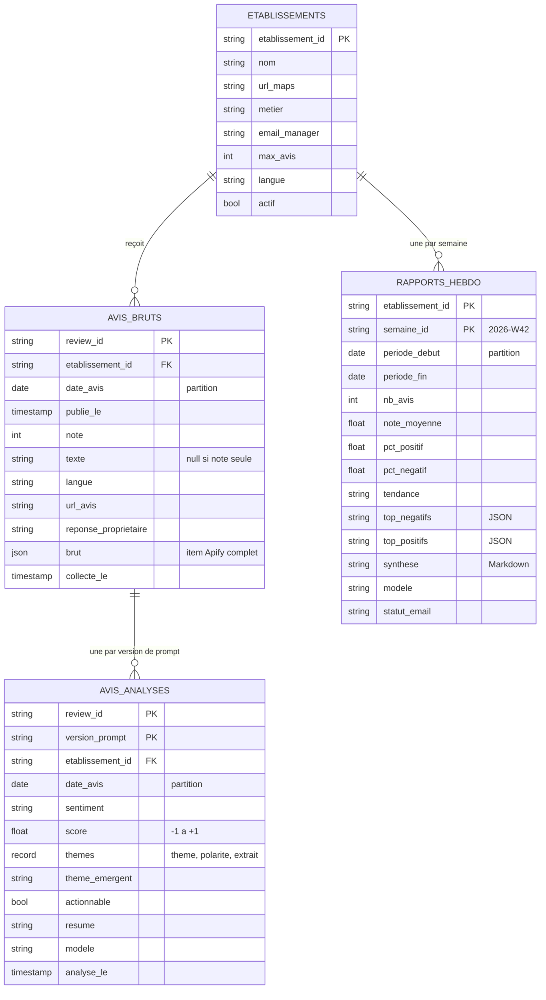
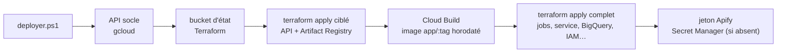

# WatchMyBusiness — architecture fonctionnelle et technique

| | |
|---|---|
| Version | 1.0 — octobre 2026 |
| Plateforme | Google Cloud, projet `watch-my-business-512316`, région `europe-west1` |
| Établissement pilote | L'As du Fallafel (restaurant, Paris) |
| Code | `app/` (Python 3.12) · infrastructure `terraform/` |

---

## Partie 1 — Architecture fonctionnelle

### 1.1 Besoin

Un gérant reçoit des dizaines d'avis Google par semaine, dans plusieurs langues.
Il n'a ni le temps de tous les lire, ni d'outil pour en dégager des tendances.

WatchMyBusiness lui envoie chaque lundi **un rapport court** qui répond à trois
questions : *comment s'est passée la semaine ?*, *qu'est-ce qui a posé
problème ou bien fonctionné ?*, *que dois-je faire en priorité ?* Un tableau de
bord permet de creuser jusqu'à l'avis individuel.

### 1.2 Acteurs

| Acteur | Rôle | Interaction |
|---|---|---|
| **Gérant** | destinataire du rapport | lit l'e-mail du lundi, consulte le tableau de bord |
| **Analyste / exploitant** | fait vivre le service | ajoute des établissements, suit les alertes, fait évoluer la taxonomie |
| **Clients de l'établissement** | auteurs des avis | publient sur Google Maps (source indirecte) |
| **Apify** | fournisseur de collecte | extrait les avis publics de Google Maps à la demande |
| **Gemini** | moteur d'analyse | classe chaque avis, rédige la synthèse hebdomadaire |

### 1.3 Capacités

### 1.4 Cycle de vie d'un avis

### 1.5 Calendrier

| Quand (Europe/Paris) | Traitement | Résultat |
|---|---|---|
| Chaque jour, 06:00 | collecte des 100 avis les plus récents, puis analyse des nouveaux | avis disponibles dans le tableau de bord le jour même |
| Chaque lundi, 08:00 | rapport de la semaine écoulée (lundi → dimanche) | synthèse en base, e-mail au gérant |
| À la demande | rejeu depuis le dépôt brut, rapport d'une semaine passée | rattrapage sans nouvelle collecte |

### 1.6 Règles de gestion

| # | Règle |
|---|---|
| RG1 | Un avis est identifié par son `reviewId` Google : une collecte répétée ne crée jamais de doublon, elle met à jour. |
| RG2 | Un avis sans texte compte dans le volume et la note moyenne, mais n'est pas analysé. |
| RG3 | Le sentiment prend une valeur parmi **POSITIF, NEGATIF, NEUTRE, MIXTE**. MIXTE = un vrai point positif et un vrai point négatif. Le texte prime sur les étoiles. |
| RG4 | Les thèmes sont choisis dans une **taxonomie fermée par métier** (8 pour la restauration), chacun avec sa polarité et un extrait cité mot pour mot. Un sujet hors liste remonte en « thème émergent ». |
| RG5 | Un avis est **actionnable** s'il signale un problème concret que le gérant peut corriger. |
| RG6 | La semaine est la semaine ISO, du lundi au dimanche, dans le fuseau Europe/Paris. |
| RG7 | Les pourcentages de sentiment se calculent sur les avis analysés. Tendance : **positive** si positifs − négatifs > 15 points, **négative** si < −15, **mitigée** sinon. |
| RG8 | Les chiffres du rapport viennent du calcul SQL et **font foi** : l'agent ne peut ni les recalculer, ni contredire la tendance. |
| RG9 | Chaque analyse porte la version du prompt qui l'a produite. Changer de version déclenche une réanalyse complète sans effacer l'ancienne. |
| RG10 | La réponse brute de la collecte est conservée telle quelle et n'est jamais modifiée. |

Taxonomie restauration : qualité de la cuisine, régularité, attente, service et
accueil, prix, hygiène, cadre et ambiance, vente à emporter.

### 1.7 Contenu du rapport hebdomadaire

| Bloc | Source |
|---|---|
| Volume, note moyenne, % positifs / négatifs / neutres / mitigés, tendance | SQL |
| Évolution par rapport à la semaine précédente | SQL (outil de l'agent) |
| Top 5 des thèmes négatifs et positifs, avec citations | SQL sur les analyses |
| **En bref**, **Ce qui a posé problème**, **Ce qui a bien fonctionné**, **Évolution**, **Actions recommandées** (3 au plus) | rédigé par l'agent Gemini, 250 mots maximum |

### 1.8 Restitution

| Canal | Public | Contenu |
|---|---|---|
| E-mail du lundi | gérant | KPI + synthèse + thèmes négatifs (si SMTP configuré) |
| Tableau de bord web | public (démonstration) | semaine, KPI, synthèse, graphiques, thèmes avec citations, avis filtrables |
| Looker Studio | analyste | exploration libre sur les vues BigQuery |

---

## Partie 2 — Architecture technique

### 2.1 Vue d'ensemble

Principes :

- **Serverless et à la demande** : aucune machine permanente. Les jobs vivent le
  temps du traitement, le service web descend à zéro instance hors trafic.
- **Une seule image Docker** pour les trois jobs et le service web : seul
  l'argument change (`collecte`, `analyse`, `rapport`, `web`).
- **Brut d'abord** : la réponse Apify est écrite dans Cloud Storage avant toute
  transformation ; BigQuery en est la vue structurée.
- **Écritures idempotentes** : tout passe par un MERGE sur une clé métier.
  Rejouer un traitement ne crée jamais de doublon.
- **Infrastructure entièrement déclarée** dans Terraform, état dans Cloud Storage.

### 2.2 Composants

| Composant | Service GCP | Rôle | Paramètres clés |
|---|---|---|---|
| `wmb-quotidien` | Cloud Scheduler | déclenche le workflow | `0 6 * * *`, Europe/Paris |
| `wmb-quotidien` | Workflows | enchaîne collecte puis analyse ; l'analyse ne démarre que si la collecte réussit | connecteur `run.v2 jobs.run` (attend la fin) |
| `wmb-rapport-hebdo` | Cloud Scheduler | lance le job rapport | `0 8 * * 1` |
| `wmb-collecte` | Cloud Run Job | Apify → GCS → BigQuery | 512 Mi, 30 min, 1 réessai |
| `wmb-analyse` | Cloud Run Job | Gemini sur les avis non analysés | 1 Gi, 30 min, 8 appels parallèles, lots de 500 |
| `wmb-rapport` | Cloud Run Job | KPI SQL + agent Gemini + e-mail | 512 Mi, 15 min |
| `wmb-web` | Cloud Run Service | tableau de bord + API | 0–2 instances, 512 Mi, cache 5 min |
| `<projet>-avis-brut` | Cloud Storage | dépôt brut immuable | versioning, Coldline à 30 j, Archive à 1 an |
| `watchmybusiness` | BigQuery | entrepôt | tables partitionnées par date, clusterisées par établissement |
| `gemini-3.5-flash` | Agent Platform (Vertex AI) | analyse et rédaction | `europe-west3`, accès par IAM (aucune clé d'API) |
| `apify-token`, `smtp-mot-de-passe` | Secret Manager | secrets lus à l'exécution | jamais dans le code ni dans Terraform |
| `pipeline` | Artifact Registry | images Docker | 10 dernières versions conservées |

### 2.3 Flux quotidien

### 2.4 Flux hebdomadaire et agent

Gemini intervient de deux façons, volontairement différentes :

| | Analyse d'un avis | Rapport hebdomadaire |
|---|---|---|
| Mode | appel unique, **sortie structurée** | **agent** avec appels d'outils |
| Contrainte | schéma JSON, thèmes en énumération, température 0 | KPI et tendance imposés dans la consigne, température 0.2 |
| Contrôle | revalidation côté code (`gemini.valider`) | chiffres issus du SQL uniquement, citations issues de l'outil |
| Pourquoi | résultat reproductible et stockable | le modèle choisit quoi creuser, le SQL garantit les chiffres |

### 2.5 Modèle de données

Vues pour la restitution (dernière analyse par avis, toutes versions confondues) :
`v_avis` (un avis par ligne), `v_themes` (une ligne par thème cité),
`v_kpi_semaine` (indicateurs par établissement et par semaine).

Le référentiel `etablissements` est alimenté par Terraform (`var.etablissements`)
via un MERGE : un établissement retiré de la configuration passe à `actif = false`
sans perdre son historique.

Dépôt brut : `gs://<projet>-avis-brut/<etablissement>/<AAAA-MM-JJ>/run-<run_id>.json`,
un fichier par collecte, avec en métadonnées l'établissement, le run Apify, le
nombre d'items et l'horodatage.

### 2.6 API du tableau de bord

Servie par `wmb-web` sur la même origine que la page (pas de CORS).

| Route | Réponse |
|---|---|
| `GET /api/etablissements` | établissements actifs |
| `GET /api/rapports?etablissement=&limite=12` | liste des rapports, du plus récent au plus ancien |
| `GET /api/rapports/{semaine_id}?etablissement=` | rapport complet + comparaison S-1, volume par jour, citations par thème |
| `GET /api/avis?etablissement=&debut=&fin=&sentiment=` | avis de la période (200 max, 62 jours max) avec leur dernière analyse |
| `GET /api/sante` | sonde de démarrage |

Requêtes paramétrées uniquement ; sentiment contrôlé par liste blanche. Côté
page, tout texte venant de la base ou du modèle est échappé avant affichage.

### 2.7 Sécurité

Trois identités, chacune avec le strict nécessaire :

| Compte de service | Utilisé par | Droits |
|---|---|---|
| `wmb-pipeline` | jobs collecte, analyse, rapport | `bigquery.jobUser`, `bigquery.dataEditor` (dataset), `aiplatform.user`, `secretAccessor` (2 secrets), `storage.objectCreator` + `objectViewer` (bucket brut), `logging.logWriter` |
| `wmb-orchestrateur` | Scheduler, Workflows | `run.invoker` (3 jobs), `run.viewer`, `workflows.invoker`, `logging.logWriter` — **aucun accès aux données** |
| `wmb-web` | tableau de bord | `bigquery.dataViewer` (dataset), `bigquery.jobUser`, `logging.logWriter` — **lecture seule** |

- **Aucune clé** : ni clé de compte de service, ni clé d'API Gemini. Tout passe par IAM.
- **Secrets** : uniquement dans Secret Manager, lus à l'exécution ; le jeton Apify
  n'apparaît ni dans le code, ni dans l'état Terraform, ni dans les journaux.
- **Dépôt brut** : accès public interdit (`public_access_prevention`), le pipeline
  ne peut ni écraser (`if_generation_match=0`) ni supprimer.
- **Données personnelles** : collecte avec `personalData: false` (pas de nom ni
  de photo d'auteur). Les avis sont publics sur Google Maps.
- **Tableau de bord public** : choix assumé pour la démonstration. Pour un usage
  réel : retirer `allUsers` et placer le service derrière IAP (comptes Google).
- **Conteneur** : image `python:3.12-slim`, utilisateur non root.

### 2.8 Fiabilité et reprise

| Situation | Comportement |
|---|---|
| Collecte Apify à 0 avis (URL sans identifiant de lieu) | URL vérifiée avant l'appel ; run vide = erreur explicite, job en échec, alerte |
| Échec après le dépôt brut | données intactes dans GCS : `rejouer --prefixe …` recharge BigQuery sans repayer Apify |
| Job relancé, collecte en double | MERGE sur `review_id` : aucun doublon |
| Quota Gemini (429) ou erreur 5xx | 4 essais, attente exponentielle (2, 4, 8 s) |
| Modèle introuvable, droits manquants (4xx) | arrêt immédiat après le premier avis, sans réessai |
| Plus de 10 % d'analyses en échec | job en échec → alerte ; les analyses réussies sont conservées, les autres seront reprises au prochain passage |
| Collecte en échec | Workflows ne lance pas l'analyse |
| Rapport à refaire | `rapport --date-fin AAAA-MM-JJ` réécrit la semaine (MERGE) |

### 2.9 Observabilité et coûts

- **Journaux** : JSON structuré avec sévérité, lisibles dans Cloud Logging ; les
  appels d'outils de l'agent sont journalisés avec leurs arguments.
- **Alerte** : toute exécution de job en échec déclenche un e-mail.
- **Traçabilité** : chaque analyse et chaque rapport stockent le modèle et la
  version de prompt utilisés.
- **Budget** : 5 € par mois, alertes à 50 % et 100 %.

Coût mesuré au démarrage (100 avis collectés, 68 analysés, un rapport) : quelques
centimes, essentiellement Apify et Gemini (~80 k jetons en entrée, ~77 k en
sortie, raisonnement inclus). BigQuery, Cloud Storage, Cloud Run, Scheduler et
Workflows restent dans les quotas gratuits ; le cache de 5 minutes du tableau de
bord limite les requêtes BigQuery facturées.

### 2.10 Déploiement

| Fichier Terraform | Contenu |
|---|---|
| `versions.tf`, `variables.tf` | fournisseur Google, backend GCS, paramètres validés |
| `apis.tf` | activation des API |
| `stockage.tf` | bucket brut, cycle de vie, droits du pipeline |
| `bigquery.tf` | dataset, tables, vues, référentiel des établissements |
| `iam.tf`, `secrets.tf` | comptes de service, rôles, secrets |
| `jobs.tf` | Artifact Registry, trois Cloud Run Jobs |
| `web.tf` | service `wmb-web`, compte en lecture seule, accès public |
| `orchestration.tf` | Workflows et Cloud Scheduler |
| `supervision.tf` | canal e-mail, alerte, budget |

Chaque déploiement produit une image au tag horodaté : revenir en arrière =
`terraform apply -var image_tag=<tag précédent>`.

### 2.11 Choix d'architecture

| Décision | Alternative écartée | Raison |
|---|---|---|
| Dépôt brut GCS avant BigQuery | ingestion directe dans BigQuery | rejouer sans repayer Apify ; corriger une normalisation boguée |
| Cloud Run Jobs | Cloud Functions | traitements longs (jusqu'à 30 min), une image commune, même code en local |
| Workflows entre collecte et analyse | deux Schedulers décalés | dépendance explicite : pas d'analyse si la collecte échoue |
| MERGE via table de transit | insertion en streaming | idempotent ; les load jobs sont gratuits |
| Sortie JSON imposée pour l'analyse | texte libre | stockable, comparable d'une semaine à l'autre |
| KPI en SQL, interprétation par l'agent | chiffres calculés par le modèle | aucun chiffre inventé |
| Taxonomie fermée + thème émergent | thèmes libres | comparabilité, sans perdre les signaux nouveaux |
| `version_prompt` stockée | écrasement des analyses | réanalyse et comparaison entre versions |
| Gemini via IAM | clé d'API | aucun secret à faire tourner |
| Une page + API sur Cloud Run | hébergement statique + API séparée | même origine, un seul déploiement |
| Terraform | console / gcloud | reproductible, revu, détruit proprement |

### 2.12 Limites et évolutions

| Limite actuelle | Évolution possible |
|---|---|
| 100 avis les plus récents par collecte | collecte rétroactive ponctuelle de l'historique |
| Tableau de bord public | IAP ou authentification Google |
| Pas d'e-mail tant que SMTP n'est pas configuré | SMTP ou service d'envoi transactionnel |
| Raisonnement de Gemini coûteux en jetons de sortie | niveau de réflexion bas ou modèle Flash Lite pour l'analyse, après comparaison sur un échantillon |
| Un seul métier en production (restaurant) | taxonomies supplémentaires dans `taxonomie.py` (le mobilier existe déjà) |
| Pas de pipeline CI | GitHub Actions : ruff, pytest, `terraform validate`, déploiement sur tag |
